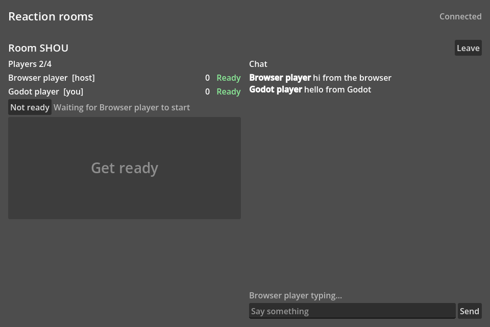

# Reaction rooms (Godot)

The [nextjs-lobby](../nextjs-lobby) game, made in Godot 4: a room list, seats
for four, a host, ready flags, kick, room chat with typing indicators, and five
rounds of "tap first after GO!". It speaks the same events as the browser
version, so Godot players and browser players can play in the same room.



## What it shows

- **The Hibira addon for Godot** (`addons/hibira`): a Pusher protocol client
  in GDScript, with public, private and presence channels, client events and
  reconnects. This is a copy of [hibira-io/godot](https://github.com/hibira-io/godot);
  take the addon for your own game from there.
- **Rooms on presence channels.** `HibiraRoom` turns `presence-room-<CODE>`
  into seats, a host, ready flags, settings, kick, start and chat, with the
  same `client-lobby-*` events as
  [@hibira-io/lobby](https://github.com/hibira-io/lobby-js).
- **Game events between players.** The host's start event carries the round
  timings, and every tap is a client event (`client-game-tap`) on the room
  channel. All of it is in `main.gd`.

## Run it

The game needs a backend that signs room subscriptions with your app secret,
which must never ship inside a game. This example uses nextjs-lobby's:

1. Set up and start [nextjs-lobby](../nextjs-lobby#run-it) (a free Hibira
   app with client events turned on, `.env.local`, `npm run dev`). It serves
   the auth endpoint and the room list on <http://localhost:3000>.
2. Open this folder in Godot 4.3 or later. Select the **Main** node and set
   **App Key** to your app's key (the key, not the secret).
3. Press **Play**. Create a room, then join it from a second Godot window
   (**Debug → Customize Run Instances**) or from nextjs-lobby in a browser
   at <http://localhost:3000/?room=CODE>. Both players press **I'm ready**,
   and the host presses **Start game**.

You can also set the values from the environment instead of the Inspector:
`HIBIRA_APP_KEY`, `HIBIRA_HOST`, `HIBIRA_PORT`, `HIBIRA_TLS=false` and
`HIBIRA_BACKEND` (default `http://localhost:3000`).

### Your own backend

Any backend that signs pusher-js subscriptions works. The game sends a form
POST with `socket_id`, `channel_name`, `user_id` and `name` to
`backend_url + auth_path`, and expects the `joined_at` field in `user_info`
that `authorizeRoom()` from `@hibira-io/lobby/server` adds. Its room list
reads `backend_url + rooms_path`, the JSON from `listRooms()`.

### Web export

On the web, Godot's WebSocket and HTTP requests go through the browser, so
two things change: add the page's origin to the app's allowed origins in the
Hibira portal, and serve the game from the backend's origin or allow it with
CORS on the auth endpoint.

## Tests

```sh
godot --headless --path godot-lobby --import
godot --headless --path godot-lobby --script res://tests/test_protocol.gd
```

They feed Pusher protocol frames to the client and check what it sends back,
with no network.

## How much it costs

The same as the browser version: each client event counts as one message on
your plan, however many players receive it. A five-round game for four
players sends a few dozen events, well within the free plan.

## Make it yours

- Take the player's ID and name from your own login in the auth endpoint.
  This demo trusts what the game sends.
- Replace the reaction game in `main.gd`. Everything about rooms stays the
  same.
- Clients are trusted once the game starts. For games where cheating matters,
  have your server check the results, or keep the game state on a game server
  and use the room only for the lobby.
