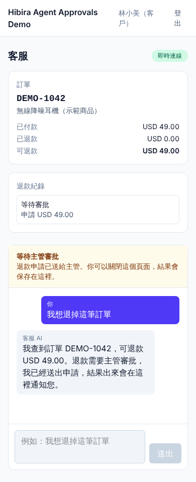
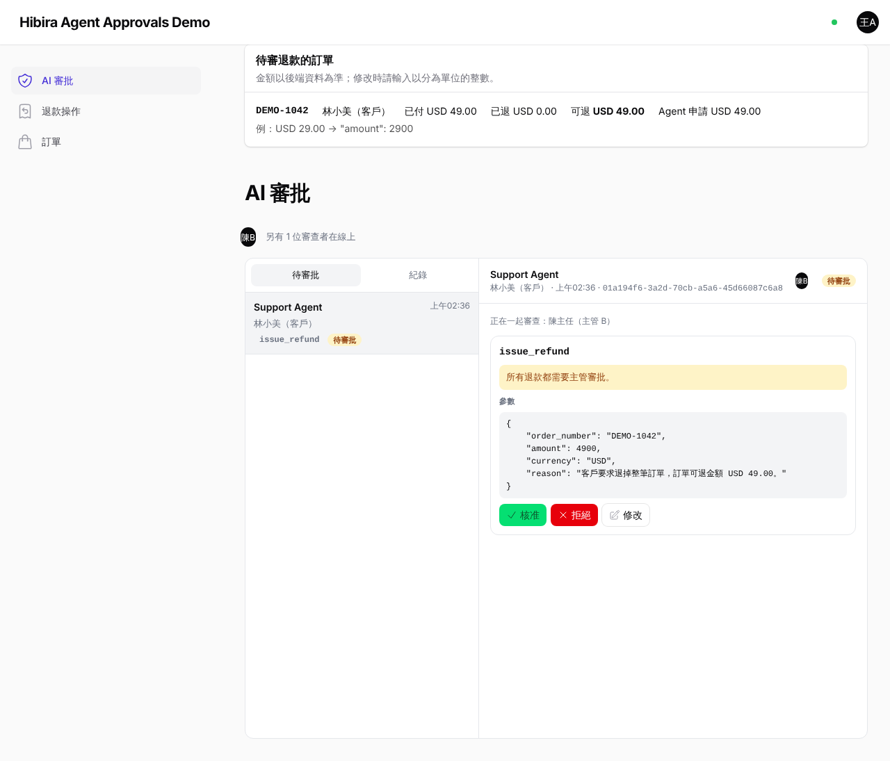
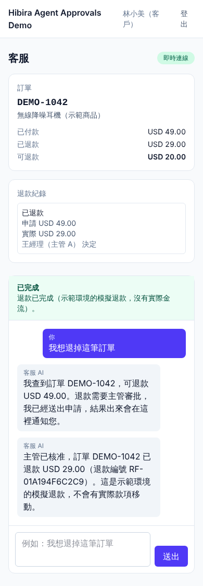
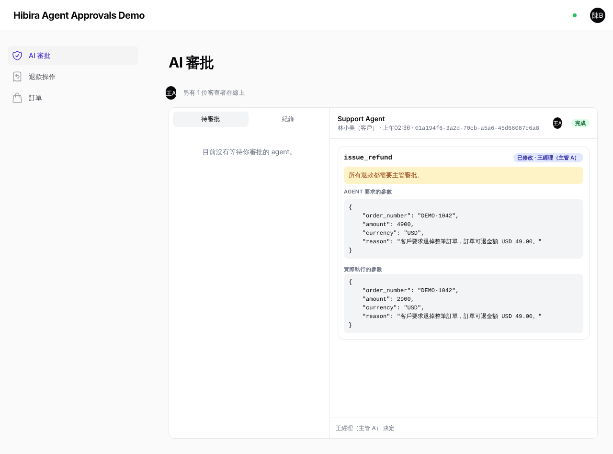
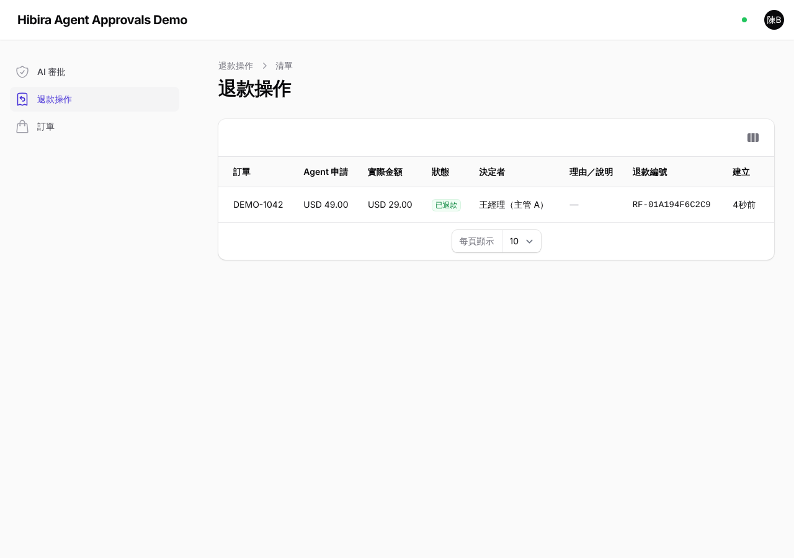

# Hibira Agent Approvals Demo

A Laravel 13 + Filament 5 example of an AI support agent that has to ask a person before it refunds money.

1. A customer asks to return an order.
2. The agent, built on the [Laravel AI SDK](https://laravel.com/docs/ai-sdk), proposes a refund.
3. Two managers see the request live in a Filament inbox ([hibira-io/filament-approvals](https://github.com/hibira-io/filament-approvals)).
4. One manager approves a lower amount.
5. The agent carries on from the queue.
6. The customer's chat updates over [Hibira](https://hibira.io).

It runs without a model API key (Mock mode). The demo UI is in Traditional Chinese.

> 中文說明在本頁最後：[中文摘要](#中文摘要)。

| Customer waits for a manager | Manager A's inbox, Manager B online |
|---|---|
|  |  |
| **Customer sees the refund live** | **Manager B's view syncs without a reload** |
|  |  |



## What it shows

- **Human approval of AI tool calls,** using the Laravel AI SDK's own tool approval.
- **A live inbox for several managers.** Each manager sees who is online, who is looking at the same request, and decisions as soon as they are made. The first decision is final.
- **Resuming the agent from the queue** after the decision, followed by an **idempotent simulated refund.** The backend generates one operation ID per refund. A unique constraint and row locks make sure it runs at most once, even after retries or a worker crash.
- **Live replies on the customer page.** After a reload or reconnect, the page recovers the state from the backend: it fetches a versioned snapshot, and when it finds a gap in the stream it resyncs instead of stitching text together.

Hibira only carries the live updates. Orders, decisions, refunds and the agent's conversation are stored in the app's own PostgreSQL database.

| Screen | Path |
|---|---|
| Customer: order summary, refunds, chat with the support agent | `/support` |
| Manager: AI approvals inbox (filament-approvals) | `/admin/ai-approvals` |
| Manager: refund operations and orders (read-only) | `/admin/refund-operations`, `/admin/orders` |

## Quick start

You need a Hibira app. Create one at [hibira.io/portal](https://hibira.io/portal); the free plan is enough and needs no card.

### With Docker (no local PHP)

```sh
cp .env.example .env
# edit .env: HIBIRA_APP_ID, HIBIRA_APP_KEY, HIBIRA_APP_SECRET
docker compose run --rm --no-deps app php artisan key:generate --show
# paste the printed base64:... into APP_KEY= in .env
docker compose up -d --build
docker compose exec app php artisan demo:reset
```

Open <http://localhost:8000>. `compose.yaml` starts three services, each with a healthcheck: the app, a queue worker, and PostgreSQL 17 on a data volume. The app image runs on [FrankenPHP](https://frankenphp.dev) (`dunglas/frankenphp:1-php8.4`, served with `frankenphp php-server`).

### With local PHP 8.3+, Node 22 and PostgreSQL

```sh
composer install
cp .env.example .env && php artisan key:generate
# edit .env: DB_* (PostgreSQL) and HIBIRA_APP_ID / HIBIRA_APP_KEY / HIBIRA_APP_SECRET
php artisan migrate
php artisan demo:reset
npm ci && npm run build

php artisan serve          # terminal 1 (or, with FrankenPHP installed: frankenphp php-server --listen 127.0.0.1:8000 --root public/)
php artisan queue:work     # terminal 2: every agent turn and every resume after a decision runs here
```

### Hibira app settings

1. Copy the **App ID, Key and Secret** from the app page into `.env`. The secret stays on the server; the browser only gets the key and host.
2. Add the address you open the demo at, for example `http://localhost:8000`, to the app's **Allowed origins**. Don't turn the origin check off for testing.
3. Run `php artisan hibira:check` to check the settings and the connection.
4. (Optional) Hibira Push: set `HIBIRA_PUSH_INSTANCE_ID` and `HIBIRA_PUSH_SECRET_KEY`, and managers who don't have the inbox open get a push notification. Without Push credentials the main flow works the same.

## Demo accounts

`php artisan demo:reset` creates the four accounts below and one order, **DEMO-1042**: USD 49.00 paid, nothing refunded yet. Every account's password is `DEMO_PASSWORD` (default `demo-password`).

| Account | Role | Can |
|---|---|---|
| `customer@demo.test` | Customer | See their order, ask for a refund, read the agent's replies |
| `manager.a@demo.test` | Manager A | Use the Filament approvals inbox: approve, edit the amount, reject |
| `manager.b@demo.test` | Manager B | The same; shows two managers in sync |
| `outsider@demo.test` | No access | Nothing; used to test authorization |

With `DEMO_MODE=true` the login page shows one-click buttons for these four accounts only. Demo accounts can only be created with `demo:reset` outside production:

- With `APP_ENV=production`, the one-click login is always off.
- `DatabaseSeeder` never creates accounts.

## Walkthrough

1. Sign in as the **customer** in one browser and open `/support`. Sign in as **Manager A** and **Manager B** in two other browsers (or private windows) and open the AI approvals page. Each manager sees that one other reviewer is online.
2. The customer types 「我想退掉這筆訂單」 ("I'd like to return this order"). The agent looks up the order, proposes a USD 49.00 refund and says it is waiting for a manager. The input is locked meanwhile.
3. The request appears in both inboxes at once, with the order's paid, refunded and refundable amounts above it. When both managers open it, each sees the other reviewing it too.
4. A manager can do one of three things:
   - **Approve** the original amount.
   - **Edit** the tool arguments, changing `"amount": 4900` to `2900`, and run it.
   - **Reject** it with a reason.
5. After the decision, the queue worker resumes the agent. An approval writes the refund; a rejection refunds nothing. Either way, the agent tells the customer the result.
6. The customer page updates live to completed or rejected, and the order's refunded amount changes. Everything is still there after a reload.

A 90-second demo script is in [docs/demo-script.md](docs/demo-script.md).

## Mock and Live modes

| | Mock (default) | Live (optional) |
|---|---|---|
| Setting | `AI_PROVIDER=demo-mock` | `AI_PROVIDER=gemini` + `GEMINI_API_KEY`, `openai` + `OPENAI_API_KEY`, or any Laravel AI SDK provider in `config/ai.php` |
| Model | `App\Ai\Mock\MockSupportGateway` returns fixed tool calls and replies based on the conversation | A real model; set `AI_MODEL` or leave it empty for the SDK default |
| Everything else | The same: SDK tool validation, approval pause, stored conversation, resume, queue, Hibira | The same |

Mock mode **replaces only the model's output.** It is a `StepTextGateway` registered as the `demo-mock` provider in `AppServiceProvider`. Tools, approvals, the database, the queue and Hibira are all real, so the whole flow works without an API key. In both modes the model can only call the simulated refund tool, and model keys are only used on the server.

```sh
php artisan demo:reset && php artisan demo:smoke                       # the whole flow without a browser (Mock)
php artisan demo:reset && AI_PROVIDER=gemini php artisan demo:smoke    # check Live mode with a real model
```

You can also demo the failure paths:

- `DEMO_MOCK_AI_FAILURE=true` makes the model call fail.
- `DEMO_MOCK_AI_FAILURE_AFTER_REFUND=true` makes the agent fail after the refund is committed but before it replies. A manager clicks Retry in the inbox, and the refund does not run twice.

## Tests

```sh
npm test                                   # client state: out-of-order, duplicate and missing events, reconnects
php artisan test --testsuite=Unit          # money formatting
php artisan test --testsuite=Feature       # flow, amount validation, authorization, retries and recovery (PostgreSQL)
php artisan test --testsuite=Concurrency   # separate PHP processes deciding and refunding at once; queue:work killed around the commit
BASE_URL=http://127.0.0.1:8000 node tests/e2e/approval-flow.mjs   # three-browser E2E (below)
```

- **Feature and Concurrency** tests run on PostgreSQL. `phpunit.xml` uses the `demo_test` database with `demo`/`demo`; override with `DB_*` environment variables. Feature tests record what would go to Hibira with `tests/Support/FakeHibira.php` and don't connect.
- **Concurrency** tests start separate PHP processes, each with its own PostgreSQL connection, that act at the same moment. The worker tests use `DEMO_CRASH_AT` to make a real `queue:work` send itself `SIGKILL` just before or just after the refund transaction commits. This only works with `APP_ENV=testing`.
- **The E2E test** needs a running app and queue worker, `DEMO_MODE=true`, `php artisan demo:reset`, and a real WebSocket server: a Hibira test app whose Allowed origins include `BASE_URL`. It checks the live sync across three browsers and that the updates came over the WebSocket, not from polling. CI runs it only when the `HIBIRA_E2E_*` secrets are set.

## Troubleshooting

| Symptom | Check |
|---|---|
| The customer page stays on "connecting" or says it can't reach the live service | `HIBIRA_APP_KEY`, `HIBIRA_HOST`; whether the app's Allowed origins include the current address; `php artisan hibira:check` |
| No new requests in the inbox, `/broadcasting/auth` returns 403 | Signed in as a manager? Is `HIBIRA_APP_SECRET` correct? |
| The customer page stays on "the agent is working" | Is `php artisan queue:work` running? `php artisan queue:health` |
| A request stays on "resuming" after a decision | Same as above; if the worker was interrupted the request turns failed, so click Retry in the inbox |
| Live mode replies that it can't answer right now | The provider error in `storage/logs/laravel.log` (a 401 means the API key is invalid) |
| Start over | `php artisan demo:reset` (clears only the demo order's data; not `migrate:fresh`) |

Diagnostic events are written to `storage/logs/diagnostics.log` as one JSON line each: `approval_requested`, `approval_decided`, `agent_resumed`, `refund_completed`, `refund_replayed` and `flow_failed`. Each line holds only the event name, related IDs, status and time. It never includes the conversation, tool arguments or any key.

## Docs

- [docs/integration.md](docs/integration.md): add the approvals packages to your own Laravel app, and which parts are required integration and which are only this demo's business logic.
- [docs/deployment.md](docs/deployment.md): environment variables, assets, migrations, the worker, HTTPS, Allowed origins, healthchecks and demo-mode limits.
- [docs/demo-script.md](docs/demo-script.md): a 90-second demo script.

## Versions

| Component | Version |
|---|---|
| PHP | 8.3+ (8.4 in Docker and CI) |
| FrankenPHP (Docker) | 1.x |
| Laravel | 13.39 |
| Filament | 5.11 |
| Livewire | 4.4 |
| laravel/ai | 1.3 |
| hibira-io/filament-approvals | 0.1.1 |
| hibira-io/filament | 0.2.3 |
| hibira-io/laravel | 0.1.2 |
| PostgreSQL | 17.6 |
| laravel-echo + pusher-js | 2 + 8 |

Versions are locked in `composer.lock` and `package-lock.json`.

## 中文摘要

這是一個 AI 客服退款審批的範例，用 Laravel 13、Filament 5、Laravel AI SDK 和 Hibira 做成。

**流程**
1. 客戶說「我想退掉這筆訂單」。
2. AI 查詢訂單後提出退款 USD 49.00。
3. 兩位主管在 Filament 收件匣即時看到這筆請求，也看得到彼此在線。
4. 其中一位可以核准、把金額改成 USD 29.00，或填寫原因後駁回。第一個決定就是最終結果。
5. 背景 queue 接著讓 AI 繼續執行。退款有冪等保護，同一筆不會退兩次。
6. 客戶頁即時看到結果，重新整理或斷線重連後狀態也不會遺失。

**啟動**
- 依照上方「Quick start」：`cp .env.example .env`，填入 `HIBIRA_*` 與 `APP_KEY`。
- 執行 `docker compose up -d --build`，再執行 `docker compose exec app php artisan demo:reset`。
- Docker 映像使用 FrankenPHP。本機開發時要另外跑 `php artisan queue:work`。

**模型模式**
- 預設是 Mock 模式，不需要任何模型 API Key。
- 設定 `AI_PROVIDER` 後可以改用真實模型。

**其他**
- App secret、模型 API Key 與 Push secret 都只放在伺服器的 `.env`，不會傳到瀏覽器。
- 示範帳號：客戶、主管 A、主管 B、無權限的路人。密碼是 `DEMO_PASSWORD`。
- 示範畫面是繁體中文。

## License

MIT
