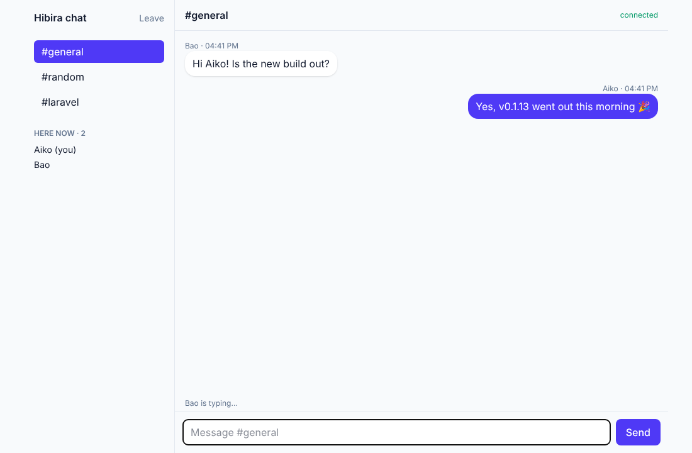
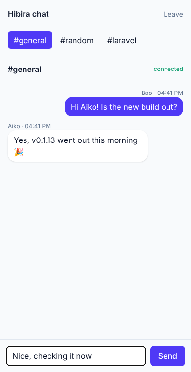

# Laravel chat

A small Slack-style chat on Laravel 13 and Hibira, using
[hibira-io/laravel](https://github.com/hibira-io/laravel).

 

| Feature | How |
|---|---|
| Rooms with a live member list | Presence channels `presence-room.{room}`, authorized in `routes/channels.php`; `here`/`joining`/`leaving` in `resources/js/chat.js` |
| Messages | `MessageSent` (`ShouldBroadcastNow`, `broadcastAs('message.sent')`), sent with `broadcast(...)->toOthers()` in `ChatController@send` |
| "… is typing" | Client events: `whisper('typing')` and `listenForWhisper`, browser to browser without your server |
| Echo client | `resources/js/echo.js`, written by `php artisan hibira:install` |

Sign-in is name-only to keep the demo short; use your app's own auth.

## Run it

You need PHP 8.3+, Composer and Node.js.

1. Create a free app on [hibira.io](https://hibira.io/portal) (no card).
   On the app page, turn on **client events** (for the typing indicator).
2. Install and configure:

   ```sh
   composer install
   cp .env.example .env
   php artisan key:generate
   php artisan migrate
   npm install && npm run build
   ```

3. Put the app ID, key and secret in `.env`:

   ```ini
   HIBIRA_APP_ID=your-app-id
   HIBIRA_APP_KEY=your-app-key
   HIBIRA_APP_SECRET=your-app-secret
   ```

   and check them with `php artisan hibira:check`.
4. `php artisan serve`, open <http://localhost:8000>, and join from two
   browser windows with different names.

Rebuild the assets (`npm run build`, or keep `npm run dev` running) after
changing `.env`, since Vite bakes the `VITE_HIBIRA_*` values into the
bundle.

## Tests

```sh
php artisan test
```

## Add Hibira to your own Laravel app

```sh
composer require hibira-io/laravel
php artisan hibira:install
npm install laravel-echo pusher-js
```

See [hibira-io/laravel](https://github.com/hibira-io/laravel) for push
notifications and webhooks.
