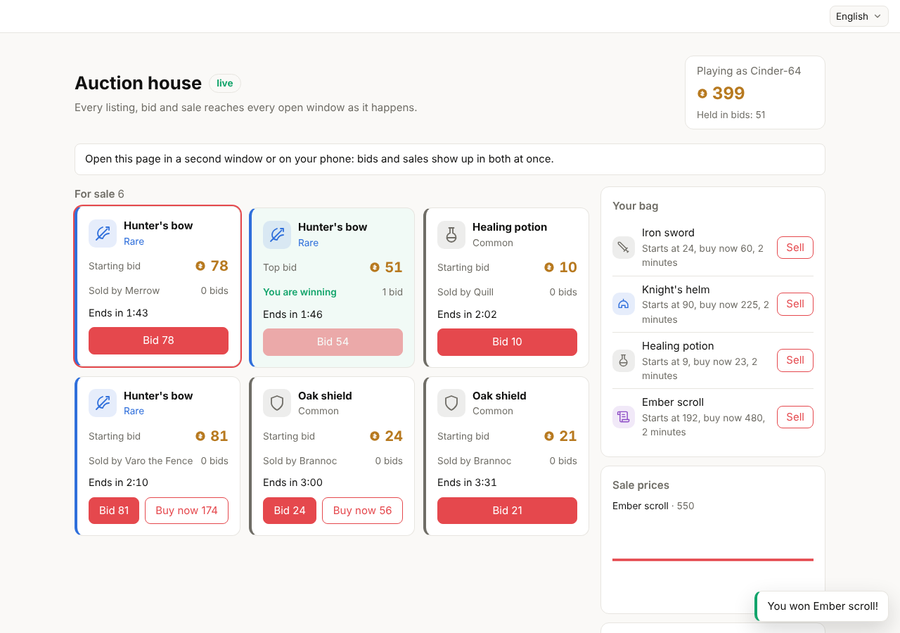

# Game auction house (Next.js)

An auction house for a made-up game, built on
[`@hibira-io/auction`](https://github.com/hibira-io/auction-js): items for
sale, live bids, countdowns, a last-seconds extension, buy now, a bag and
the sale prices of each item. Everything moves in every open browser at once.



## What it shows

- **The server decides.** `lib/game.ts` creates the house with
  `createAuctionHouse()` from `@hibira-io/auction/server`. The routes in
  `app/api/auction/` call `house.bid()`, `house.buyout()` and `house.list()`;
  the house checks each bid, holds the bidder's gold through `reserve()`, gives
  it back through `release()` when someone bids higher, and moves the item and
  the gold in `settle()` when an auction ends.
- **One message per change.** Each change is published once on the
  `auction-main` channel with the [`pusher`](https://www.npmjs.com/package/pusher)
  Node SDK pointed at Hibira. Every open page receives it, however many there are.
- **Catching up.** `components/AuctionView.tsx` opens the house with
  `AuctionHouse.open()` from `@hibira-io/auction`, which loads
  `GET /api/auction` on every (re)subscription, so a page that was offline
  misses nothing. Countdowns follow the server's clock.
- **Last-seconds bids.** A bid in the last 15 seconds moves the end to 15
  seconds from now, so nobody wins by sniping.
- **NPC traders.** A few traders list items and bid near the end, so the house
  is never empty. Remove `npcTurn()` in a real game.

## Run it

1. Create a free app on [hibira.io](https://hibira.io/portal) (no card) and
   open its page.
2. Copy `.env.example` to `.env.local` and fill in the app ID, key and
   secret.
3. Start it:

   ```sh
   npm install
   npm run dev
   ```

4. Open <http://localhost:3000> in two windows (or one on your phone) and bid
   in one: the other updates at once and tells you when you are outbid.

The house, the wallets and the bags live in the server's memory, so run it as
one long-running Node server (`npm run build && npm start`, or any host that
keeps a Node process running). On serverless hosts each function instance
would have its own house; give `createAuctionHouse()` a `store` on your
database there (see the package README).

## Use it in your game

- Take the player from your own sign-in in `lib/api.ts`, not from the request.
- Replace the wallets and bags in `lib/game.ts` with your database in
  `reserve`, `release` and `settle`. `settle` runs until it succeeds, so make
  it idempotent by `listing.id`.
- Game clients on other engines can follow the same `auction-main` channel
  with any Pusher client and send bids to the same endpoints.

Each published change counts as one message; deliveries to players count
towards the plan's monthly deliveries.
