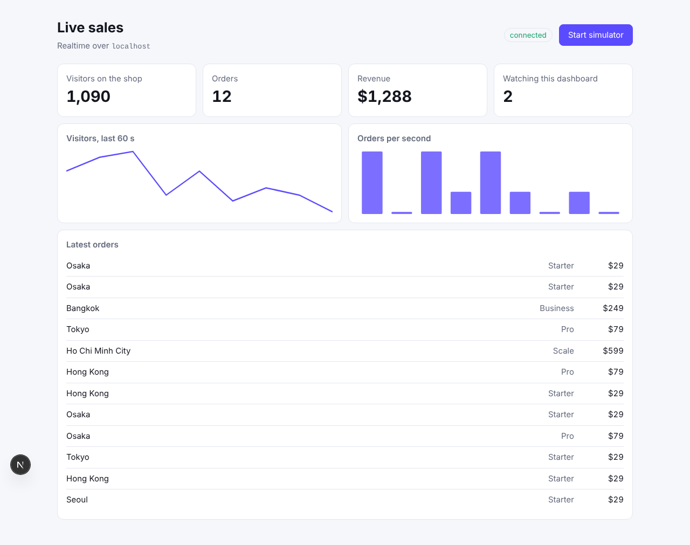

# Live sales dashboard (Next.js)

A dashboard that updates in every open browser at once: KPIs, two charts,
an order feed and a live count of who is watching.

[](https://stackblitz.com/github/hibira-io/examples/tree/main/nextjs-dashboard?file=.env.example)



## What it shows

- **Publishing from the server.** `app/api/tick/route.ts` calls
  `trigger()` from the [`pusher`](https://www.npmjs.com/package/pusher) Node
  SDK, pointed at Hibira with `host`. The secret never reaches the browser.
- **Subscribing in the browser.** `components/Dashboard.tsx` connects with
  [`pusher-js`](https://www.npmjs.com/package/pusher-js) to `ws.hibira.io`
  and updates on each `tick` event of the `dashboard` channel.
- **A large presence channel.** "Watching this dashboard" comes from
  `presence-large-dashboard-viewers` through
  [`@hibira-io/large-presence`](https://github.com/hibira-io/large-presence-js),
  which keeps an exact count from five viewers to 100,000.
- **Channel authorization.** `app/api/hibira/auth/route.ts` signs presence
  subscriptions. A real app checks its own session there.

## Run it

1. Create a free app on [hibira.io](https://hibira.io/portal) (no card) and
   open its page.
2. Copy `.env.example` to `.env.local` and fill in the app ID, key and
   secret.
3. Start it:

   ```sh
   npm install
   npm run dev
   ```

4. Open <http://localhost:3000>, press **Start simulator**, then open the
   same page in a second tab or on your phone. Every open dashboard moves
   together, and the viewer count goes up.

On StackBlitz, create `.env.local` in the file tree with the same values,
then restart the dev server from the terminal.

The simulator runs in the tab where you started it: that tab asks the
server to publish one made-up tick a second. In a real app the server
publishes when something happens (an order is paid, a job finishes).

## Use it with your own data

Replace `nextTick()` in `lib/metrics.ts` with your events and call
`hibira().trigger('dashboard', 'tick', data)` from wherever they happen: a
route handler, a server action, a queue worker or a webhook.

Events count against your plan's daily messages when published; each
delivery to a browser is free.
