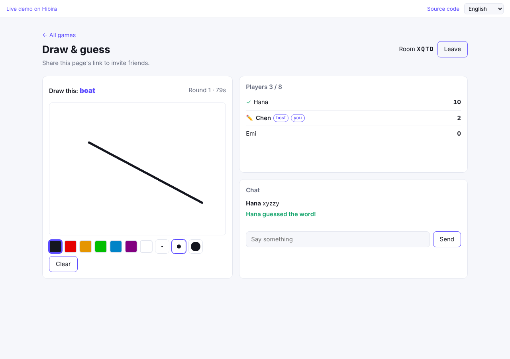

# Party games (Next.js)

Three small multiplayer games that run on client events: a shared pixel
canvas, draw & guess, and Connect Four. No database and no game server: the
browsers on a channel play the game between them, and the app's only server
code signs subscriptions and lists rooms.

[](https://stackblitz.com/github/hibira-io/examples/tree/main/nextjs-games?file=.env.example)
[](https://vercel.com/new/clone?repository-url=https%3A%2F%2Fgithub.com%2Fhibira-io%2Fexamples%2Ftree%2Fmain%2Fnextjs-games&env=HIBIRA_APP_ID,HIBIRA_APP_SECRET,NEXT_PUBLIC_HIBIRA_APP_KEY&envDescription=App%20ID%2C%20secret%20and%20key%20from%20your%20Hibira%20app%20page%20%28the%20free%20plan%20is%20enough%29&envLink=https%3A%2F%2Fhibira.io%2Fportal&project-name=hibira-games)
[](https://app.netlify.com/start/deploy?repository=https://github.com/hibira-io/examples&base=nextjs-games&create_from_path=nextjs-games)



## What it shows

- **Pixel canvas** (`components/Canvas.tsx`). Everyone paints on one 32 × 32
  board on `presence-canvas`. A pixel is one `client-canvas-paint` event,
  and a painter has 5 pixels of ink that refill one a second. The board
  lives only in the browsers: the member with the lowest ID sends it to each
  newcomer (`client-canvas-board`, 1 KB), so when everyone has left it
  starts over.
- **Draw & guess** (`components/Draw.tsx`). Rooms of up to 8 on
  `presence-draw-XXXX`, with seats, host and chat from
  [`@hibira-io/lobby`](https://github.com/hibira-io/lobby-js). The host runs
  the rounds and keeps the scores; the drawer's points go out in batches
  every 150 ms. The word stays secret: the drawer sends salted hashes of
  every accepted answer, in all seven languages, and each guesser checks a
  guess against them before sending it, so a right answer never shows up
  in the chat.
- **Connect Four** (`components/Four.tsx`). Rooms of 2 on
  `presence-four-XXXX`. A game is the list of moves, and both players check
  each move the same way (right game, right turn, right player, a column
  with room), so both boards stay the same.
- **Plain auth.** `app/api/hibira/auth/route.ts` signs the canvas with the
  player's ID and name, and the rooms with `authorizeRoom`, which adds
  `joined_at` for seats and refuses a full room. `app/api/rooms/route.ts`
  lists a game's open rooms.

## Run it

1. Create a free app on [hibira.io](https://hibira.io/portal) (no card),
   open its page and turn on **Allow client events (whisper, typing
   indicators)** in its settings.
2. Copy `.env.example` to `.env.local` and fill in the app ID, key and
   secret.
3. Start it:

   ```sh
   npm install
   npm run dev
   ```

4. Open <http://localhost:3000>, pick a game and open the same page in a
   second browser or on your phone.

On StackBlitz, create `.env.local` in the file tree with the same values,
then restart the dev server from the terminal.

To put it online, press **Deploy with Vercel** at the top. Vercel copies
this folder into a new repository in your GitHub account and asks for the
app ID, secret and key. The API routes run as Vercel functions, and browsers
connect straight to Hibira, so nothing on Vercel holds a WebSocket open.

Netlify works the same way, and [Zeabur](https://zeabur.com) can deploy it from
[`deploy/zeabur/nextjs-games.yaml`](../deploy/zeabur/nextjs-games.yaml). Wherever it runs,
add the site's address (for example `https://hibira-games.vercel.app`) to
**Allowed origins** in the app's settings on hibira.io, or browsers can't
connect.

## How much it costs

Each client event counts as one message on your plan, however many people
receive it. A painter sends at most one pixel a second once the ink is out;
a drawer sends up to about seven batches of points a second while drawing;
a Connect Four move is one event. The free plan's daily messages are plenty
for testing.

## Make it yours

- Take the user's ID and name from your own session in
  `app/api/hibira/auth/route.ts`. This demo trusts what the browser sends.
- Client events are checked by the other players, not by a server: fine for
  casual games among friends. For games with stakes, send moves to your
  server, check them there and publish the result.
- To keep the canvas when everyone leaves, save it on your server and load
  it on open, or have your server publish it on a `cache-` channel.
