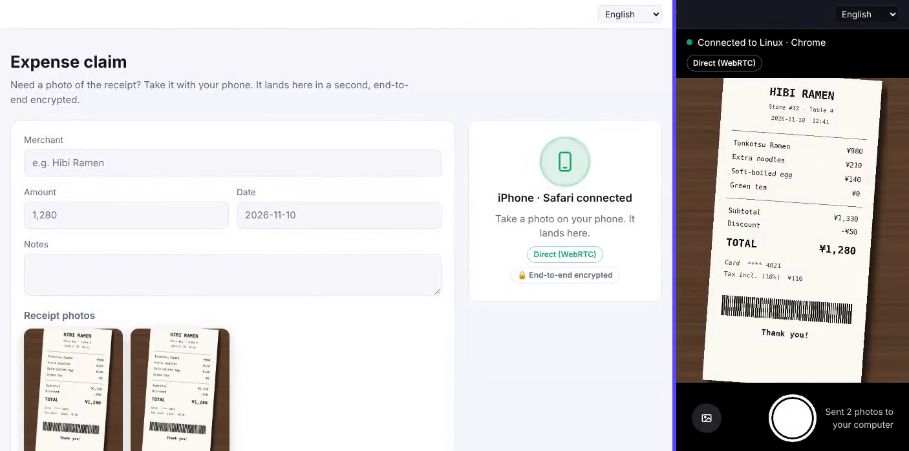

# Phone to desktop handoff (Next.js)

An expense form on the computer needs a photo of the receipt. Scan the QR
code with your phone, take the photo, and it lands in the form a moment
later. No app, no sign-in, no upload server, and the photo is end-to-end
encrypted: Hibira only ever relays ciphertext.

[](https://stackblitz.com/github/hibira-io/examples/tree/main/nextjs-handoff?file=.env.example)
[](https://vercel.com/new/clone?repository-url=https%3A%2F%2Fgithub.com%2Fhibira-io%2Fexamples%2Ftree%2Fmain%2Fnextjs-handoff&integration-ids=oac_BDiFKkVaaw4jAnV7wOcdMBUe&project-name=hibira-handoff)
[](https://app.netlify.com/start/deploy?repository=https://github.com/hibira-io/examples&base=nextjs-handoff&create_from_path=nextjs-handoff)



## What it shows

- **Pairing by QR code.** The desktop page makes a random 128-bit code and a
  256-bit AES-GCM key. The QR code holds
  `/phone/?hh=<code>#hk=<key>`: the key sits in the `#fragment`, which
  browsers never send to a server.
- **A two-seat presence channel.** Both pages join
  `presence-handoff-<code>`. The auth route (`app/api/hibira/auth/route.ts`)
  refuses a third member, and each side sees the other's device name
  ("iPhone · Safari", "Windows · Edge").
- **WebRTC with Hibira as signaling.** When the phone joins, the desktop
  page offers a WebRTC data channel; the offer, answer and ICE candidates
  travel as client events. Photos then go browser to browser.
- **A relay that always works.** On networks where WebRTC can't connect
  (there is no TURN server here), the photo goes as encrypted chunks of
  client events on the same channel, paced under the 10 a second limit,
  and is made a little smaller first. The badge says which way it went.
- **Instant feedback.** A 40-pixel preview travels ahead of the photo, so
  the computer shows a blurred photo flying in at once and sharpens it
  when the last chunk arrives.

All of it comes from the [`@hibira-io/handoff`](https://www.npmjs.com/package/@hibira-io/handoff)
package (`npm install @hibira-io/handoff`): `createHandoff` in the pages
`components/Desk.tsx` and `components/Phone.tsx`, and `authorizeHandoff`
in the auth route. The package also has a React hook and a one-line
`<hibira-handoff>` element if you'd rather not wire it up yourself.

Measured against a local Hibira server with an 860 KB photo: direct in about
0.2 s; relayed in about 1 s with 7 KB chunks (10 KB event limit, Hobby and
up) and about 3 s with 2.7 KB chunks (free plan's 4 KB limit).

## Run it

1. Create a free app on [hibira.io](https://hibira.io/portal) (no card),
   open its page and turn on **Allow client events (whisper, typing
   indicators)** in its settings.
2. Copy `.env.example` to `.env.local` and fill in the app ID, key and
   secret. On a paid plan, set `NEXT_PUBLIC_RELAY_CHUNK_BYTES=7000` for a
   faster relay.
3. Start it:

   ```sh
   npm install
   npm run dev
   ```

4. Open <http://localhost:3000>. Your phone can't reach `localhost`, so
   either deploy it (below) or press **Copy the phone link** and open it in
   another browser on the computer. Phones only show the live camera
   preview on `https` pages; elsewhere the shutter opens the camera app.

Wherever it runs, add the site's address to **Allowed origins** in the
app's settings on hibira.io, or browsers can't connect.

## How much it costs

Over WebRTC, a photo costs nothing on Hibira beyond about a dozen signaling
events per pairing. Over the relay, each chunk is one message: a 150 KB
photo is about 22 messages with 7 KB chunks. Nothing is stored.

## Make it yours

- Tie the code to the signed-in user's session in the auth route, so only
  their own phone can join.
- Save the photo where your form saves its files once it has arrived on
  the computer; the phone never needs your upload endpoint.
- Pass a TURN server in the `iceServers` option of `createHandoff` if most
  of your users are on networks that block peer-to-peer.
- The same pairing works for anything small: a signature drawn on the
  phone, a scanned ID, a document from the phone's files.

## 中文摘要

電腦上的報銷表單需要收據照片：用手機掃 QR 碼、拍照，照片約一秒內出現在電腦表單裡。不用 App、不用登入、沒有上傳伺服器；金鑰放在 QR 碼網址的 `#` 後面，不會傳到伺服器，照片全程端對端加密。優先用 WebRTC 直連（Hibira 只做信令），連不上時改用 Hibira 頻道的 client event 分段傳送。核心邏輯來自 npm 套件 `@hibira-io/handoff`（另有 React hook 與一行即用的 `<hibira-handoff>` 元素）。
