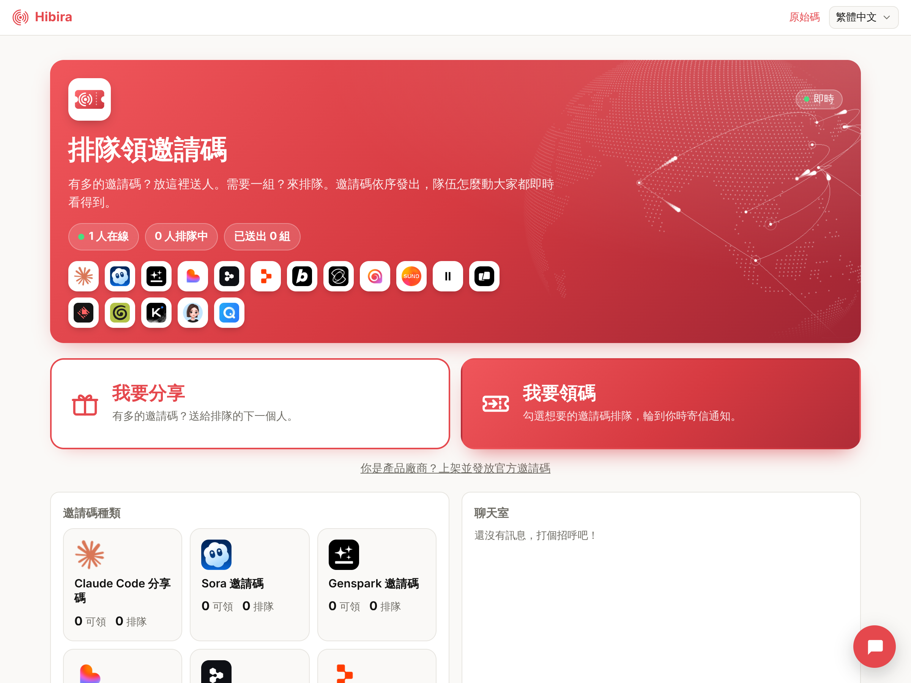

# Invite code queue with a chat room (Next.js)

One queue for spare invite codes. The first page has two big buttons, *I want
to share* and *I want a code*. People who have a code give it on the share
page (`/give`); people who want one sign in with an email code and get in line
for the products they want on the get page (`/get`). Each code goes to the next person in line who wants it, and they have
6 hours to take it before it moves on. A chat room sits beside the line,
and everyone sees the line, the counts and the people online change live.

Live: [demos.hibira.io/examples/invite-queue](https://demos.hibira.io/examples/invite-queue/)



## What it shows

- **The rules in one file.** `lib/invite-queue.js` holds everything: email
  sign-in codes, the line, matching codes to people, the 6-hour hold, taking
  or passing an offer, reports on codes that did not work, chat with rate
  limits and moderation. It has no network or storage of its own; the API
  routes give it memory storage and your Hibira app, and Hibira's hosted demo
  runs the same file in a Cloudflare Durable Object with real email.
- **Public counts, private turns.** Changes to the line are announced on the
  public channel `invite-queue` (`state`, plus `chat` and `chat-removed`
  for the chat). What concerns one person ("a code is yours", "your offer
  ran out") goes to their private channel `private-invite-queue-<user id>`,
  which `app/api/pusher/auth` signs only for that person's session. Codes
  never travel over a channel: only `GET /state` with the person's own
  session answers the code they took.
- **Read again on change.** The page reads `GET /state` once and again after
  each `state` event, spread over a moment so a busy line does not send
  every page to the server at the same instant.
- **Who is here.** The online count is the `invite-queue` channel's
  subscription count (`pusher:subscription_count`). Turn on
  *Subscription count* on your app's settings page for it.

- **Vendors sign up themselves** (`/vendor`). A company email (or a DNS
  TXT record `_hibira-invite-queue.<domain>`) verifies a domain; then the
  vendor lists its product or takes over the one already listed there, puts
  official codes in by the batch (up to 1,000, from the page or with an API
  key: `Authorization: Bearer vk_…`), and gets signed webhooks
  (`code.taken`, `code.reported`, `codes.empty`; header
  `Hibira-Signature: t=…,v1=<HMAC-SHA256 of "t.body">`).
- **Installable.** The hosted page has a web app manifest and a small
  service worker (`public/sw.js`) that keeps the page's shell, so it can be
  added to the home screen and opens offline; the line and the chat always
  come from the network.

## Run it

1. Create a free app on [hibira.io](https://hibira.io/portal) (no card) and
   open its page. Turn on *Subscription count* in its settings.
2. Copy `.env.example` to `.env.local` and fill in the app ID, key and
   secret.
3. Start it:

   ```sh
   npm install
   npm run dev
   ```

4. Open <http://localhost:3000> in two windows and sign in with two
   addresses. The sign-in codes are printed in the terminal (this app sends
   no email). Get in line in one window, give a code in the other.

`npm test` runs the rules' tests.

The queue lives in the server's memory, so it starts empty on every restart
and needs one long-running Node server. For your own site, give
`InviteQueue` a `storage` with `get`, `put`, `delete` and `list` on your
database (the Durable Object storage API has this shape), and a `sendMail`
that sends the two emails (`kind: "code"` and `kind: "turn"`).

## Change it

- **Products:** `INVITE_PRODUCTS` in `.env.local`, as JSON
  (`[{"id":"lovable","name":"Lovable","icon":"lovable.png"}]`; `names`
  adds a name per language, `icon` is a file in `public/products` or an https
  URL).
- **Bot check:** set `NEXT_PUBLIC_TURNSTILE_SITE_KEY` and
  `TURNSTILE_SECRET_KEY` from a Cloudflare Turnstile widget, and sending an
  email code needs the check (`verifyHuman` in `InviteQueue`).
- **Moderators:** `INVITE_ADMINS`, a comma-separated list of emails. After
  signing in they can remove chat messages and ban people.
- **Timing:** `HOLD_MS` (how long an offer waits), `CLAIM_COOLDOWN_MS` (how
  long after taking a code someone can line up again) and the other limits
  are at the top of `lib/invite-queue.js`.

Each published event counts as one message; deliveries count towards the
plan's monthly deliveries.
