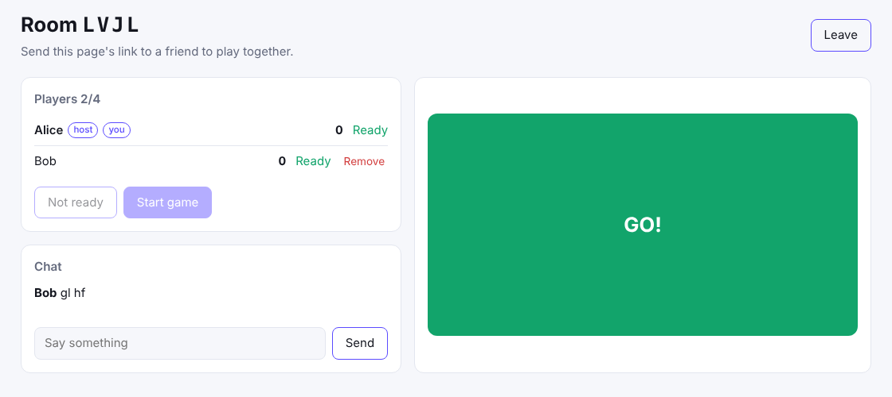

# Reaction rooms (Next.js)

A small multiplayer game: create a room, send the link to a friend, get
ready, and the host starts five rounds. Whoever taps first after "GO!" wins
the round. There is a room list, seats for four, a host, ready flags, kick,
and room chat with typing indicators. No game server, no database.

[](https://stackblitz.com/github/hibira-io/examples/tree/main/nextjs-lobby?file=.env.example)



## What it shows

- **Rooms on presence channels.** Each room is `presence-room-<CODE>`.
  [`@hibira-io/lobby`](https://github.com/hibira-io/lobby-js) turns it into
  seats, a host, ready flags, settings, kick, start and chat
  (`components/RoomView.tsx`). When the host leaves, the next player takes
  over.
- **Seats and capacity decided on the server.** `app/api/hibira/auth/route.ts`
  signs subscriptions with `authorizeRoom()`, which adds the join time that
  every player uses to agree on seats and the host, and refuses a fifth
  player.
- **A room list without a database.** `app/api/rooms/route.ts` asks the HTTP
  API for occupied `presence-room-` channels and their member counts with
  `listRooms()`. A room exists while someone is in it.
- **Game events between browsers.** The host's start event carries the round
  timings, and every tap is a client event (`client-game-tap`) on the room
  channel, so the game runs without a server in the middle.

## Run it

1. Create a free app on [hibira.io](https://hibira.io/portal) (no card),
   open its page and turn on **Allow client events (whisper, typing
   indicators)** in its settings.
2. Copy `.env.example` to `.env.local` and fill in the app ID, key and
   secret.
3. Start it:

   ```sh
   npm install
   npm run dev
   ```

4. Open <http://localhost:3000>, create a room, and open the room's link in a
   second tab or on your phone. Both players press **I'm ready**, then the
   host presses **Start game**.

On StackBlitz, create `.env.local` in the file tree with the same values,
then restart the dev server from the terminal.

## How much it costs

Each client event counts as one message on your plan, however many players
receive it. A five-round game for four players sends a few dozen events. The
free plan's daily messages are plenty for testing.

## Make it yours

- Take the player's ID and name from your own session in
  `app/api/hibira/auth/route.ts`. This demo trusts what the browser sends.
- Replace the reaction game in `lib/game.ts` and `components/RoomView.tsx`.
  Everything about rooms stays the same.
- Clients are trusted once the game starts. For games where cheating
  matters, have your server check the results, or keep the game state on a
  game server and use the room only for the lobby.
