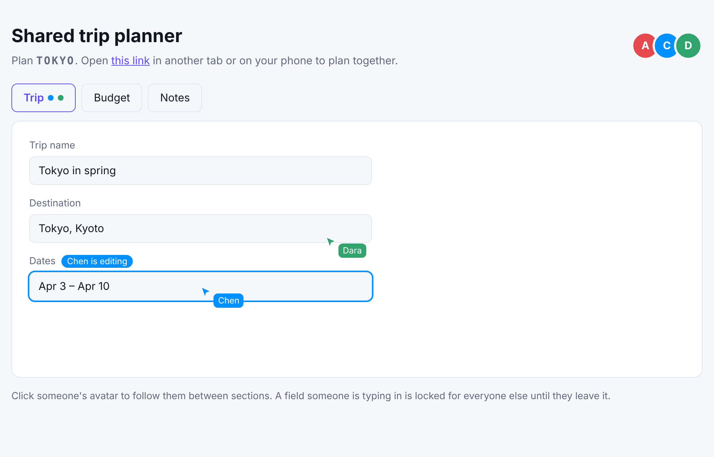

# Shared trip planner (Next.js)

A form several people fill in together: avatars of everyone in the plan, live
cursors, a lock on the field someone is typing in, and follow mode between
sections. No database and no server besides the auth route.

[](https://stackblitz.com/github/hibira-io/examples/tree/main/nextjs-spaces?file=.env.example)
[](https://vercel.com/new/clone?repository-url=https%3A%2F%2Fgithub.com%2Fhibira-io%2Fexamples%2Ftree%2Fmain%2Fnextjs-spaces&env=HIBIRA_APP_ID,HIBIRA_APP_SECRET,NEXT_PUBLIC_HIBIRA_APP_KEY&envDescription=App%20ID%2C%20secret%20and%20key%20from%20your%20Hibira%20app%20page%20%28the%20free%20plan%20is%20enough%29&envLink=https%3A%2F%2Fhibira.io%2Fportal&project-name=hibira-spaces)



## What it shows

- **A space on a presence channel.** Each plan is `presence-plan-<CODE>`.
  [`@hibira-io/spaces`](https://github.com/hibira-io/spaces-js) turns it into
  members with a color and a location, cursors and locks
  (`components/Planner.tsx`).
- **Who's here and where.** The avatar stack lists everyone in the plan, and
  each tab shows dots for the people on it. A member's location is the tab
  they have open.
- **Live cursors.** Pointer moves are sent four times a second in batches and
  replayed smoothly. You only see the cursors of people on your tab.
- **Field locks.** Focusing a field locks it; others see who is editing it and
  can't type there until that person leaves the field or the page.
- **Follow mode.** Click an avatar to follow that person between tabs.
- **Plain auth.** `app/api/hibira/auth/route.ts` signs an ordinary presence
  subscription with the user's ID and name. A space needs nothing more.

Field contents travel as the app's own client events (`client-plan-field`),
and the member with the lowest ID sends the plan so far to newcomers. A real
app saves the plan in its database and loads it on open.

## Run it

1. Create a free app on [hibira.io](https://hibira.io/portal) (no card),
   open its page and turn on **Allow client events (whisper, typing
   indicators)** in its settings.
2. Copy `.env.example` to `.env.local` and fill in the app ID, key and
   secret.
3. Start it:

   ```sh
   npm install
   npm run dev
   ```

4. Open <http://localhost:3000> and open the plan's link in a private
   window, another browser or on your phone (tabs of one browser share a
   user).

On StackBlitz, create `.env.local` in the file tree with the same values,
then restart the dev server from the terminal.

To put it online, press **Deploy with Vercel** at the top. Vercel copies
this folder into a new repository in your GitHub account and asks for the
app ID, secret and key. The API routes run as Vercel functions, and browsers
connect straight to Hibira, so nothing on Vercel holds a WebSocket open.

## How much it costs

Each client event counts as one message on your plan, however many people
receive it. A cursor moving all the time sends four events a second; typing
sends one event each time the typist pauses. The free plan's daily messages
are plenty for testing.

## Make it yours

- Take the user's ID and name from your own session in
  `app/api/hibira/auth/route.ts`, and check they may open the plan. This demo
  trusts what the browser sends.
- Save fields to your database, and check edits there if locks matter: locks
  are a UI hint that the server does not enforce.
- For long text edited by several people at once, use a CRDT library such as
  Yjs for the text and keep the space for presence, cursors and locks.
