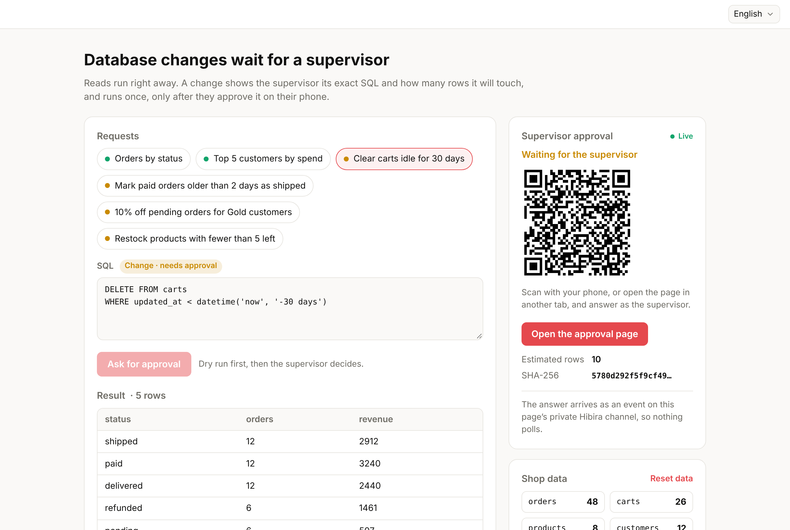

# Supervisor approval for database changes (Next.js)

Staff, scripts and assistants can read the shop database freely, but a
change waits for a supervisor. The supervisor sees the exact SQL, how many
rows it will touch and its SHA-256 on a Hibira-hosted approval page (open
it from the QR code on a phone), and the statement runs once, only after
they approve. The answer reaches the page as an event on its private
Hibira channel, so nothing polls.

[](https://stackblitz.com/github/hibira-io/examples/tree/main/nextjs-sql-approvals?file=.env.example)
[](https://vercel.com/new/clone?repository-url=https%3A%2F%2Fgithub.com%2Fhibira-io%2Fexamples%2Ftree%2Fmain%2Fnextjs-sql-approvals&integration-ids=oac_BDiFKkVaaw4jAnV7wOcdMBUe&project-name=hibira-sql-approvals)
[](https://app.netlify.com/start/deploy?repository=https://github.com/hibira-io/examples&base=nextjs-sql-approvals&create_from_path=nextjs-sql-approvals)



## What it shows

- **Reads run, changes wait.** `classifySql()` from
  [`@hibira-io/approvals/sql`](https://github.com/hibira-io/approvals#gate-database-writes)
  sorts each statement. Anything it is unsure of (several statements, a
  data-modifying CTE, `EXPLAIN ANALYZE`...) counts as a change, and reads
  run with writes switched off (`PRAGMA query_only`), so a misjudged
  statement fails instead of writing.
- **A preview the supervisor can judge.** Before asking, the page runs the
  change inside a savepoint and rolls it back to count the rows, and adds
  the query plan (`lib/shop.ts`).
- **Approval bound to the exact statement.** `app/api/approvals/route.ts`
  sends the statement, row count, plan and SHA-256 to Hibira's approvals
  HTTP API (`POST /apps/APP_ID/approvals`) with the page's private channel.
  Before running, the page checks the statement against that fingerprint
  with `assertApprovedSql()`: approving one statement never runs another.
- **Pushed, not polled.** Hibira sends an `approval` event on
  `private-sqlgate-<random>` when the supervisor decides. The page reads the
  answer once (`app/api/approvals/[id]/route.ts`) to confirm it, then runs
  the statement once.
- **No database credentials leave your side.** Hibira only sees the
  statement and its preview; the database stays where it is.

Here the database is SQLite ([sql.js](https://sql.js.org)) in the page,
standing in for your server, so the example runs with nothing else
installed. In production the dry run, the fingerprint check and the run
belong on your server: the guide
[Supervisor approval for database changes](https://hibira.io/use-cases/database-write-approvals)
shows them with PostgreSQL, and the same pattern in the Vercel AI SDK,
Mastra, LangGraph, Laravel, n8n, Make, Activepieces and Dify.

## Run it

1. Create a free app on [hibira.io](https://hibira.io/portal) (no card).
2. Copy `.env.example` to `.env.local` and fill in the app ID, key and
   secret.
3. Start it:

   ```sh
   npm install
   npm run dev
   ```

4. Open <http://localhost:3000>, pick **Clear carts idle for 30 days** and
   press **Ask for approval**. Open the approval page from the QR code on
   your phone (or the button, in another tab) and approve or reject it.

## Live demo

[demos.hibira.io/examples/nextjs-sql-approvals](https://demos.hibira.io/examples/nextjs-sql-approvals/)
runs the same page. There, changes come from the ready-made requests only:
the demo backend sends just those statements for approval.
