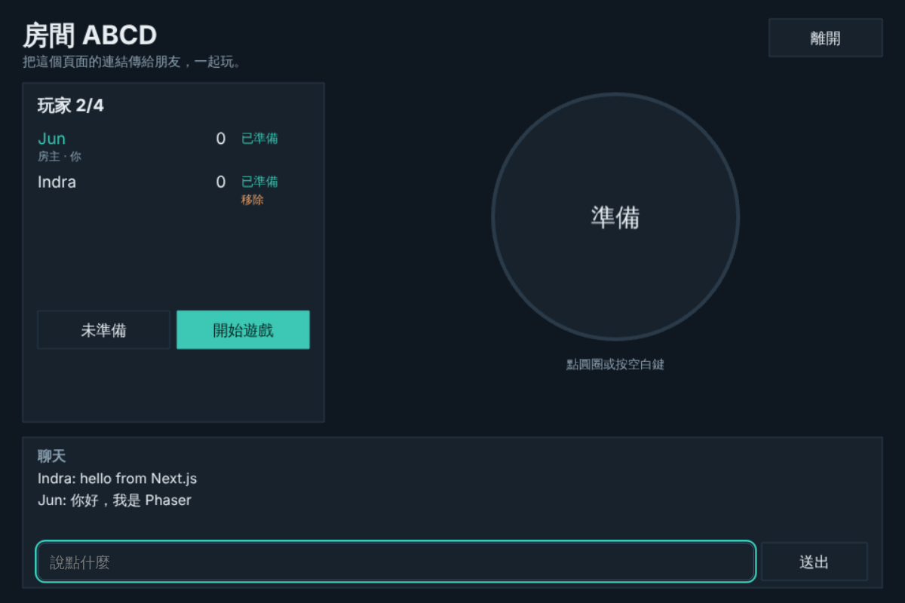

# Reaction rooms (Phaser)

The [nextjs-lobby](../nextjs-lobby) game, made with Phaser 4: a room list,
seats for four, a host, ready flags, kick, room chat with typing indicators,
and five rounds of "tap first after GO!", all drawn in a canvas. It sends
the same events as the browser and [Godot](../godot-lobby) versions, so
Phaser, browser and Godot players can play in the same room.



## What it shows

- **@hibira-io/lobby in a game engine.**
  [`@hibira-io/lobby`](https://github.com/hibira-io/lobby-js) only needs
  pusher-js, so it works in Phaser as it is. `src/scenes/RoomScene.ts` turns
  `presence-room-<CODE>` into seats, a host, ready flags, kick, start and
  chat.
- **Game events between players.** The host's start event carries the round
  timings, and every tap is a client event (`client-game-tap`) on the room
  channel. The rules are nextjs-lobby's `lib/game.ts`, copied to
  `src/game.ts`.
- **Text input that works with IMEs.** Names and chat are real `<input>`
  elements over the canvas (`dom: { createContainer: true }`), so Chinese,
  Japanese and Korean input methods and phone keyboards work.

## Run it

The game needs a backend that signs room subscriptions with your app secret,
which must never ship inside a game. This example uses nextjs-lobby's:

1. Set up and start [nextjs-lobby](../nextjs-lobby#run-it) (a free Hibira
   app with client events turned on, `.env.local`, `npm run dev`). It serves
   the auth endpoint and the room list on <http://localhost:3000>.
2. Copy `.env.example` to `.env.local` here and set `VITE_HIBIRA_APP_KEY`
   to the same app's key (the key, not the secret).
3. Start it:

   ```sh
   npm install
   npm run dev
   ```

4. Open <http://localhost:5173>, create a room, and open the room's link in
   another browser or a private window (tabs of one browser share a
   player), or open <http://localhost:3000/?room=CODE> there to join from the
   browser version. Both players press **I'm ready**, and the host presses
   **Start game**. Tap the circle or press Space after "GO!".

The dev server forwards `/api` to nextjs-lobby (`vite.config.ts`), so the
game and its backend share an origin and need no CORS. Set `LOBBY_BACKEND`
if nextjs-lobby runs somewhere else.

### Your own backend

Any backend that signs pusher-js subscriptions works. The game posts
`socket_id`, `channel_name`, `user_id` and `name` to `/api/hibira/auth` and
expects the `joined_at` field in `user_info` that `authorizeRoom()` from
`@hibira-io/lobby/server` adds. Its room list reads `/api/rooms`, the JSON
from `listRooms()`. Both paths are in `src/net.ts`.

## How much it costs

The same as the browser version: each client event counts as one message on
your plan, however many players receive it. A five-round game for four
players sends a few dozen events, well within the free plan.

## Make it yours

- Take the player's ID and name from your own login in the auth endpoint.
  This demo trusts what the game sends.
- Replace the reaction game in `RoomScene.ts`. Everything about rooms stays
  the same.
- Clients are trusted once the game starts. For games where cheating matters,
  check results on your server.
